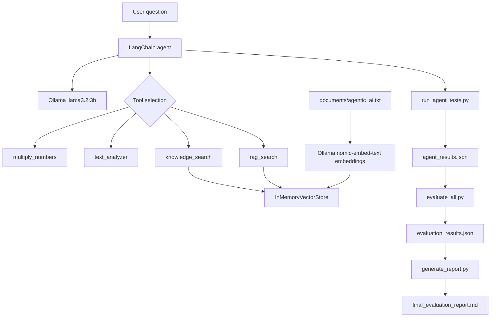

# Agentic AI Evaluation System

A local LangChain agent powered by Ollama, with test cases and evaluation using DeepEval and deterministic checks.

## Architecture



## What the project tests

- **Tool selection:** Whether the agent chooses the expected tool for a question.
- **Tool execution:** Whether tool execution succeeds and outputs are checked against expectations (see `evaluate_tool_execution.py`).
- **Answer relevancy:** Whether answers address the question (DeepEval, using a configured evaluator model).
- **Faithfulness:** Whether knowledge-based answers are supported by retrieved context (DeepEval).

## Prerequisites

- Python and Conda (optional)
- Ollama installed and running locally
- Ollama models: `llama3.2:3b` and `nomic-embed-text`

```powershell
ollama pull llama3.2:3b
ollama pull nomic-embed-text
ollama list
```

## Setup

```powershell
conda create -n agentic_ai python=3.11 -y
conda activate agentic_ai
python -m pip install -r requirements.txt
```

If you already have working `agentic_ai` and `agentic_eval` environments, you can keep them rather than recreate them. Install DeepEval in the evaluation environment; use your tested package versions where possible. Avoid downgrading `click` in the agent environment if it conflicts with `huggingface-hub`.

## Run

From the project root:

```powershell
python agent.py
python run_agent_tests.py
```

Then, in the environment with DeepEval and the evaluation dependencies:

```powershell
python evaluate_all.py
python generate_report.py
```

`generate_report.py` reads `evaluation_results.json` and writes `final_evaluation_report.md`.

## Observed initial results

In the initial four-question run:

| Metric | Passed | Evaluated |
|---|---:|---:|
| Tool selection | 4 | 4 |
| Answer relevancy | 4 | 4 |
| Faithfulness | 2 | 2 |

These results are from a small, guided test set and do **not** establish general reliability. Some prompts explicitly name the expected tool, making selection easier. Expand testing with paraphrases, ambiguous requests, negative cases, unexpected inputs, and failures. Also verify actual tool outputs, not only tool names.

## Key files

| File | Purpose |
|---|---|
| `agent.py` | LangChain agent, Ollama model, tools, local retrieval |
| `run_agent_tests.py` | Invokes the agent and saves actual calls and answers |
| `agent_results.json` | Raw run results (generated) |
| `evaluate_all.py` | Runs evaluation metrics and writes JSON |
| `evaluation_results.json` | Metric results (generated) |
| `generate_report.py` | Creates the Markdown evaluation report |
| `documents/agentic_ai.txt` | Local knowledge source |

## Security and reproducibility

Never commit `.env`, API keys, or credentials. Pin dependency versions after confirming the working environment using `python -m pip freeze > requirements-lock.txt` (review it before publishing). Ollama is local; no OpenAI API key is needed when every evaluator metric explicitly uses your configured local model.

## Limitations

- The vector store is in-memory and recreated on startup.
- The knowledge base currently consists of a small local text file.
- LLM-based evaluator scores can vary across runs.
- A passing tool-selection check does not prove correct execution or factual accuracy.

## System Architecture

The system uses LangChain to orchestrate an AI agent powered
by a locally running Ollama model.

The agent supports four tools:

1. Multiply Numbers
2. Text Analyzer
3. Knowledge Search
4. RAG Search

The system uses an in-memory vector store and Ollama
embeddings for knowledge retrieval.

DeepEval evaluates the agent using:

- Tool Correctness
- Answer Relevancy
- Faithfulness

[View Architecture Diagram](docs/architecture.md)

## Evaluation Results

The initial evaluation was performed using four test cases.

| Metric | Passed | Evaluated | Accuracy |
|--------|--------|-----------|----------|
| Tool Correctness | 4 | 4 | 100% |
| Answer Relevancy | 4 | 4 | 100% |
| Faithfulness | 2 | 2 | 100% |

These results represent the initial test dataset and
do not establish performance on unseen questions.

## Running the Project

Start Ollama and ensure the required models are available.

```powershell
ollama pull llama3.2:3b
ollama pull nomic-embed-text

